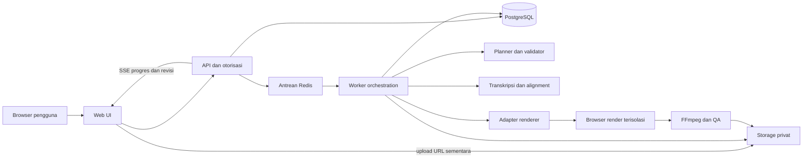

# Arsitektur, struktur repo, dan deployment

## 1. Baseline repo yang ditemukan

Repo saat perencanaan adalah repo editorial dengan pipeline episode, bukan aplikasi
web umum. `editorial-engine/package.json` sudah berisi React, Remotion, TypeScript,
font dan tooling FFmpeg; belum ada API, database produk, UI upload, atau antrean job.
`editorial-engine/pipeline/story-engine/` memiliki gate mekanis dan receipt review;
README-nya menyatakan belum terhubung otomatis ke pipeline episode lama.

Contoh lokal episode Gibran menggunakan halaman OpenFilm/SVG serta skrip di
`scripts/render-gibran-openfilm.sh` dan `scripts/openfilm-local-chrome.mjs`.
Sebagian source episode dan tool lokal masih merupakan perubahan working tree saat
rencana ini dibuat, sehingga **tidak dijamin ada di checkout agen remote**. Agen harus
mengaudit tree aktual dan mencatat file yang tersedia; baseline benchmark harus tetap
dapat berjalan dengan fixture sintetis tanpa media privat/arsip ZIP/tool `.scratch`.

Keterikatan pada nama episode, scene bernomor, path lokal, geometri khusus, serta
perintah manual perlu diganti dengan kontrak generik. Pipeline arsip jangan diubah
massal atau dianggap otomatis memenuhi standar baru.

## 2. Diagram proses



Browser pengguna tidak merender master penuh sebagai jalur produksi. Aplikasi web
menampilkan preview; worker menjalankan tugas berat, tetap hidup walau tab ditutup.
Satu codebase dapat dipakai lokal maupun server dengan konfigurasi storage/browser.

## 3. Pilihan stack dan boundary

| Lapisan | Pilihan rancangan | Alasan dan batas |
|---|---|---|
| Web | Next.js + React + TypeScript | Route, UI, player, formulir; tidak menjalankan render panjang dalam request |
| API | Fastify + TypeScript + OpenAPI | Kontrak eksplisit dan reusable untuk UI/worker; service modular tunggal |
| Kontrak | Zod + JSON Schema hasil generate | Validasi di API, worker, dan UI; satu sumber kebenaran |
| Metadata | PostgreSQL + Prisma migrations | Relasi, transaksi, revisi, ownership, outbox |
| Antrean | BullMQ + Redis | Retry, concurrency, cancel, dedup; DB tetap sumber status otoritatif |
| Media | S3-compatible provider; filesystem adapter untuk dev | Storage privat; URL sementara; tidak menulis blob ke DB/Git |
| Render | Adapter Node, satu engine produksi hasil spike | Preview/final memakai scene evaluator yang sama |
| Audio | FFmpeg/ffprobe + adapter ASR/alignment | Python runner terpisah bila provider membutuhkan; jangan memasang semua model |
| AI | Provider interface + implementasi awal tunggal | Budget, timeout, schema output, provenance, fixture offline |
| Auth | OIDC melalui pustaka terawat | Single-owner awal, workspace ACL di API; tidak menulis crypto auth sendiri |
| Deploy | Container web/api/worker; Postgres/Redis/storage terpisah | Migrasi eksplisit, private ingress untuk worker; tidak perlu Kubernetes MVP |

Versi di atas adalah pilihan desain, bukan perintah instalasi terkini. Fase 0 wajib
memverifikasi kompatibilitas Node/React/Next/renderer serta lisensi dan menulis lockfile.
Gunakan pnpm workspace baru dengan pin `packageManager`; jangan mencampur npm dan pnpm
di workspace yang sama. `editorial-engine/` tetap legacy npm dengan lockfile-nya pada
migrasi awal; root workspace mengecualikannya sampai migrasi terpisah disetujui.

## 4. Struktur target yang harus dibangun

```text
Content-Creator/
  README.md                              # tambahkan pintu masuk Studio
  docs/content-studio/                    # spesifikasi ini dan ADR hasil spike
  apps/
    studio-web/
      src/app/                           # routes; tanpa business logic render
      src/features/projects/
      src/features/imports/
      src/features/storyboard/
      src/features/scene-editor/
      src/features/reviews/
      src/features/renders/
      src/features/settings/
      src/components/                    # shell, form, feedback, player controls
      src/lib/api/                       # client dari kontrak OpenAPI
    studio-api/
      src/modules/{auth,workspaces,projects,uploads,imports}/
      src/modules/{revisions,scenes,reviews,jobs,renders,artifacts}/
      src/modules/{styles,providers,budgets,health}/
      src/plugins/                       # auth, DB, request ID, rate limit
      src/outbox/                        # transaksi DB -> enqueue aman
    studio-worker/
      src/processors/{ingest,align,plan,assets,preview,render,qa}/
      src/runtime/                       # lease, heartbeat, cancellation, limits
  packages/
    contracts/                           # schemas, time, errors, API/event types
    domain/                              # state machine, revisions, ownership rules
    db/                                  # Prisma schema, migrations, repository funcs
    storage/                             # S3/local provider, hashing, signed access
    queue/                               # enqueue, outbox dispatch, job envelopes
    timeline/                            # global/local clock, frame/sample conversion
    audio/                               # metadata, waveform, clip mapping, alignment
    planner/                             # semantic plan, cues, fallback, validation
    styles/                              # versioned style profiles, tokens, constraints
    scene-kit/                           # SVG objects, rigs, actions, compositions
    renderer-core/                       # engine-independent render contract
    renderer-selected/                   # adapter yang dipilih fase 0; nama final via ADR
    providers/                           # LLM/ASR/image/3D adapter + cost accounting
    quality/                             # timing, geometry, decode, content review mapping
    legacy-bridge/                       # wrapper story_gate.py dan import read-only
    observability/                       # structured logs, metrics, redaction
  workers/audio-python/                   # hanya jika adapter terpilih memerlukannya
  fixtures/content-studio/                # data sintetis; media generate saat test
  tests/{contract,integration,e2e,render}/
  infra/{docker,compose,deploy}/
  pnpm-workspace.yaml
  package.json
  pnpm-lock.yaml
  editorial-engine/                       # arsip + bridge; tidak dipindahkan fase awal
  scripts/                               # legacy tetap; command Studio terpisah
```

`packages` adalah batas kepemilikan dan dependensi, bukan alasan membuat abstraksi
berlebihan. Modul kecil boleh berada dalam package yang sama selama public interface
jelas. Tidak boleh ada import `apps/*` dari `packages/*`. UI tidak mengakses DB/Redis;
renderer tidak memanggil LLM; planner tidak menjalankan browser; provider tidak boleh
mengubah revision secara langsung. Daftar komponen UI ada di spesifikasi UI.

## 5. Tanggung jawab pemrosesan

1. Ingest memvalidasi upload, hash, MIME aktual, metadata audio, dan normalisasi timestamp.
2. Audio service membangun waveform, transkripsi jika perlu, serta cue kata/frasa.
3. Planner memahami narasi, menyusun object map, keadaan sebelum/sesudah, tindakan,
   komposisi, cue, dan hubungan antarscene. Output berupa SceneSpec, bukan source JS.
4. Asset resolver memilih aset yang sudah ada atau membuat aset opsional; mencatat
   provenance, lisensi, biaya, dan revisi. Gagal generasi tidak boleh diganti aset acak.
5. Compiler scene menghubungkan SceneSpec ke scene-kit whitelist dan style profile.
6. Renderer menjalankan evaluasi waktu deterministik; assets/font siap sebelum frame 0.
7. QA membedakan cek mekanis dari review manusia dan menghasilkan artifact/report.
8. API menyimpan hasil secara atomik dan UI menampilkan state aktual.

Scene-kit awal: `ObjectNode`, `Anchor`, `Connector`, `Label`, `Camera2D`, `FocusMask`,
`SubtitleTrack`, `Background`, `DiagramGroup`; action `move`, `attach`, `detach`,
`replace`, `reveal`, `flow`, `compare`, `split`, `merge`, `highlight`, `camera`.
Composition awal: cause-effect, comparison, flow-network, object-replacement,
layer-cross-section, quantified-scale. Masing-masing memiliki parameter bertipe,
bounds, keadaan awal/akhir, seek support, dan fixture. Grafis harus menjelaskan aksi;
jumlah template tidak menjadi ukuran kualitas.

## 6. Migrasi bertahap

| Saat ini | Tujuan | Cara migrasi |
|---|---|---|
| Path/episode di skrip | Project + EpisodeRevision + Asset ID | Import read-only; resolver mengganti path absolut dengan storage key |
| Timeline episode | Normalized timeline | Konversi teruji; simpan input asli dan mapping; jangan overwrite |
| Switch scene bernomor | SceneSpec + composition/action registry | Ekstrak pola umum; geometri episode tetap sebagai contoh opsional |
| Film frame evaluator lokal | RendererAdapter | Pertahankan seek semantics; benchmark sebelum pilih engine |
| VO tunggal atau terpotong | AudioClip array dengan trim/source offset | Jangan menolak potongan kontinu yang valid atau menimpa edit Studio |
| Salin scene opening | Clip instance merujuk scene revision | Instance punya durasi/range; sumber dan 24 scene asli tetap utuh |
| Manual preflight | Quality pipeline + legacy gate adapter | Exit code dan receipt hash dibaca; draft/final dibedakan |
| Deliverables lokal | Artifact manifest + private storage | Unduhan via ACL/signed URL; status complete setelah upload dan QA |

Snapshot lama disimpan sebagai legacy, tidak otomatis dinaikkan statusnya. Hook ulang
sebagai visual-only atau audio+visual harus eksplisit; durasi episode dihitung ulang
berdasarkan composition, bukan penjumlahan VO yang bisa menduplikasi audio.

## 7. Determinisme dan cache

Frame `f` dievaluasi dari `f/fps`, SceneSpec, asset hashes, style version, seed, dan
renderer build. Hindari waktu dinding, `Math.random()` tanpa seed, animasi yang bergantung
pada urutan playback, font jaringan tak dipin, serta fetch bebas ketika render.
GSAP timeline dipause dan di-seek eksplisit. Simulasi 3D dibake atau dihitung dari waktu.

Cache key memasukkan scene revision, aset, style, evaluator/renderer version, seed,
resolusi, fps dan konfigurasi warna. Alignment bergantung hash audio + transkrip +
versi aligner; ganti warna tidak mengulang ASR. Ganti satu scene menginvalidasi scene
tersebut dan tetangga yang punya transisi/continuity dependency. Audio mix dan export
manifest tetap dibangun ulang jika composition berubah. Render scene dipisah untuk
resume; audio akhir dimux sekali dari sample timeline agar tidak timbul celah encoder.

## 8. Deployment dan lingkungan

Dev: web/API + worker lokal, Postgres/Redis container, filesystem privat di luar
repo; Chrome standar melalui konfigurasi path. Sediakan health check binary dan
versi, writable temp directory, ruang disk, codec, dan render smoke test.

Server awal: satu host/container stack dengan domain TLS, auth wajib, storage privat,
worker CPU terpisah dari web/API. Python/GPU worker baru ketika ada kebutuhan yang
terbukti. Serverless web boleh dipakai; render panjang tetap pada worker persistent.
Compose production harus memisahkan credential, volume, backup, dan private network;
tidak mengekspose Postgres/Redis/debug browser ke internet.

Browser standard Chrome lokal tidak dipasang paksa ulang. Runtime deployment boleh
menggunakan Chrome/Chromium yang kompatibel dan dipin. Simpan capability report
(browser version, renderer, GPU/software fallback); GUI desktop tidak diperlukan di
server. Jangan gunakan profil Chrome pribadi atau flag nonisolasi secara default.

Konfigurasi yang harus dibuat sebagai `.env.example` kosong: `DATABASE_URL`,
`REDIS_URL`, `STORAGE_DRIVER`, `STORAGE_BUCKET`, `STORAGE_ENDPOINT`, `STORAGE_ROOT`,
`STORAGE_ACCESS_KEY_ID`, `STORAGE_SECRET_ACCESS_KEY`, `OIDC_ISSUER`, `OIDC_CLIENT_ID`,
`OIDC_CLIENT_SECRET`, `SESSION_SECRET`, `PUBLIC_WEB_URL`, `API_ORIGIN`,
`RENDER_BROWSER_EXECUTABLE`, `RENDER_CONCURRENCY`, `AI_PROVIDER`, `AI_API_KEY`,
`PROJECT_BUDGET_LIMIT`. Secret tidak memakai prefix public frontend. Contoh konfigurasi
harus memakai placeholder, bukan credential nyata.

## 9. Privasi dan isolasi sebagai kebutuhan produk

- Workspace/project ownership diperiksa untuk semua resource, SSE, dan URL unduhan.
- Upload memakai batas ukuran/durasi dan format allowlist; path/object key dibuat
  server; filename asli metadata saja; tolak zip dan DOCX zip-bomb.
- URL aset diresolve melalui provider terkontrol; blok akses network internal/metadata.
- Render menerima manifest aset lokal read-only, network dibatasi, CPU/mem/disk/time
  dibatasi, temp per-job; render job tidak memiliki secret DB/AI kecuali worker induk.
- Instruksi di naskah/DOCX diperlakukan sebagai data, bukan perintah agen atau shell.
- Jangan memakai shell interpolation untuk nama file, prompt, atau argumen pengguna.
- Log merekam ID/hash/angka, bukan VO, naskah penuh, signed URL, cookie, atau API key.
- Enkripsi transit dan akses storage privat; kebijakan retensi dan penghapusan jelas.
  Backup data privat tidak pernah menjadi commit Git publik.

## 10. Operasi, recovery, dan biaya

DB transaction menulis job + outbox. Dispatcher enqueue dengan job ID stabil; worker
mengambil lease, memberi heartbeat, menyimpan checkpoint. Retry idempotent; output
lama tidak ditimpa sebelum artifact baru lolos. Reconciler memulihkan job pending
atau lease kedaluwarsa setelah restart. Jangan mengandalkan SSE/Redis sebagai satu-
satunya sumber status; API snapshot dari DB menyelesaikan reconnect.

Cancel bersifat kooperatif lalu terminasi child setelah grace period, tanpa menghapus
artifact sukses. Delete project menolak/menunda jika job masih aktif; batalkan dan
bersihkan sesuai retention. Lifecycle storage membersihkan upload yatim/temp setelah
TTL, bukan input aktif. DB backup + asset manifest diuji dengan restore ke lingkungan
terpisah sebelum deploy production.

Budget diset per project dan per tahap; reserve estimasi sebelum provider call,
reconcile biaya aktual, batasi retry dan token. Tampilkan biaya unknown secara jujur.
Budget habis -> `blocked_budget`; pengguna dapat melanjutkan setelah perubahan limit.
Track queue wait, stage duration, render fps, peak RAM, error rate, cost, cache hit,
heartbeat lag, dan disk usage. Readiness API berbeda dari kemampuan worker render.
