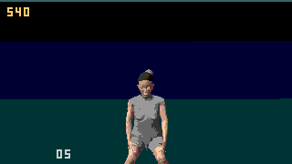
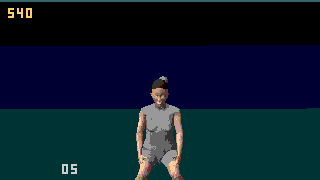
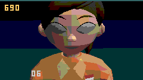

# Animasi hidup — lapisan gerak di atas klip

Dokumen ini menjelaskan **kenapa** aktor studio sempat terasa seperti patung,
apa yang ditambahkan untuk memperbaikinya, dan bagaimana mengukurnya. Rujukan
gayanya tetap [ANIMATION&MOTION.md](../../ANIMATION&MOTION.md) (§6 karakter,
§9 irama per beat).

## 1. Masalahnya, dengan angka

Shot duduk di `warung-hujan` memakai klip `sit` — pose duduk yang praktis statis.
Satu-satunya gerak yang tersisa berasal dari `secondary.js` dengan amplitudo
±0,6°, yang di 768 px tidak terbaca. Terukur dengan `npm run qc:life`:

| shot | aktor | sebelum (mm/frame) | sesudah | frame beku |
| --- | --- | --- | --- | --- |
| busri-05 | bu-sri | 0,53 | 4,21 (×7,9) | 7 → 0 |
| nisa-06 | nisa | 0,54 | 5,74 (×10,7) | 5 → 0 |
| nisa-08 | nisa | 0,53 | 7,07 (×13,3) | 6 → 0 |
| bayu-07 | bayu | 0,59 | 7,69 (×13,0) | 4 → 0 |
| dua-shot-16 | nisa | 0,53 | 1,26 (×2,4) | 8 → 0 |

`mm/frame` = perpindahan terbesar tulang kepala/tangan antar frame (30 fps).
Ambang praktis: di bawah ±0,6 mm/frame sebuah shot dialog terbaca sebagai
gambar diam. "Frame beku" = frame dengan perpindahan < 0,05 mm.

## 2. Bug yang ditemukan saat mengukur

1. **Reset pose per operasi** (`applySecondary`). Dua operasi pada tulang yang
   sama saling menghapus — napas + ayunan + fidget tidak pernah bertemu.
   Sekarang reset dilakukan sekali per tulang per panggilan (`Set`).
2. **Tulang gestur tidak terdaftar.** `prepareSecondary` hanya menyiapkan
   `SECONDARY_BONES`, sehingga putaran untuk `jaw`, `clavicle`, `upperarm02`,
   `wrist`, `oculi01`, `oris05` dibuang diam-diam. Sekarang `LIFE_BONES` ikut.
3. **Skala wajah menumpuk.** Rig membuka mulut lewat `oris05.scale.y` dan
   memejamkan mata lewat `oculi01.scale.y`. Mengalikan skala tiap frame tanpa
   mengembalikan pose istirahat membuat kelopak mata menyusut sampai 0 —
   terukur **69 dari 150 frame buta**. Perbaikannya: `clip-sample.js` kini
   memisahkan `scaleNodes` (node yang skalanya ditulis klip) dari
   `animatedNodes`, dan `applySecondary` mengembalikan `restScale` lebih dulu.
4. **Properti ikut bergoyang.** Geseran berat badan sempat diterapkan ke semua
   instans ber-klip; sekarang dibatasi ke aktor manusia (`isCharacter`).
5. **Bukaan mulut terlalu kecil.** Pose istirahat `oris05.scale.y` hanya 0,19,
   jadi mengalikannya tidak pernah terbaca. Diganti operasi `scaleTo`
   (lerp ke nilai absolut 0,78).

## 3. Isi lapisan (`src/studio/life.js`)

| komponen | berkas/fungsi | dasar praktik |
| --- | --- | --- |
| napas 3,4–4,2 s | `A.breathChest`, `breathShoulder`, `breathBob` | siklus napas 2–4 s, dada mengembang, kepala nyaris diam |
| tumpuan berat badan 7,2–9,4 s | `holdWave()` + `A.weightShift` | *moving hold* di ujung ayunan, bukan sinus rata |
| kedip 2,6–4,4 s | `blinkAmount()`, `eye.L/eye.R` | tutup 0,07 s, jadwal tidak rata (bukan metronom) |
| bicara | `speechGate()`, `mouthOpen()`, `scaleTo('oris05')` | frasa 2,4–3,5 s, suku kata semu dari dua osilator |
| angguk bicara | `beatWave()` pada `head`/`neck03` | antisipasi → aksi → *moving hold* → *overshoot* → settle |
| gestur tangan | `beatWave()` pada `upperarm01/02`, `lowerarm01/02`, `wrist` | lengan bergerak di busur (dua sumbu), tangan terlambat 110 ms |
| mendengarkan | `beatWave()` amplitudo 55 % | pengangguk kecil, bukan gerakan penuh |
| fidget 8,5–14 s | `fidget()` | variasi idle 2–4 gerakan supaya loop tidak terbaca |
| mikro-gerak | `A.shimmer` (5,13 s & 2,71 s) | menjamin tidak ada frame identik |

Tulang ujung selalu **terlambat** dari pangkal (`lag` 0,07 s kepala, 0,11 s
tangan) — itu *overlapping action*, sumber rasa "berat" yang wajar.
Saat klip sudah mengayun lengan (`walk`/`run`), gestur bicara dikecilkan ke 25 %
supaya tetap *subordinate* (prinsip *secondary action*).

Semua fungsi murni terhadap waktu lokal shot: Remotion merender frame dalam
urutan acak dan paralel, jadi tidak boleh ada state yang menumpuk.

## 4. Menyetel dan memeriksa

```bash
cd studio
npm run qc:life                       # angka: mm/frame + frame beku per shot
npm run preview:cpu -- --shot busri-05 --range 540,689,2 --width 320 --gif
npm run preview:cpu -- --shot nisa-08 --frames 968,996,1024 --width 384 --trail
npm run test:studio                   # 34 grup asersi + three.js runtime
```

Knoop yang paling sering dipakai ada di tabel `A` (`life.js`): naikkan
`breathChest`/`weightRoll` untuk aktor yang lebih ekspresif, turunkan
`armBeat` untuk aktor yang sedang menahan diri. `intensity` per shot berasal
dari `shot.secondary` di `story.json`.

Bukti visual (raster CPU, bukan Chromium):

*  — bicara, gestur tangan + angguk
*  — pembanding, pose klip saja
*  — kedip & mulut
* `animasi/busri-05-hidup.png` / `animasi/busri-05-tanpa.png` — lembar kontak
* `animasi/kepala-nisa-08-kedip2.png` — rangkaian kedip (frame 997–1004)
* `animasi/dua-shot-16.png` — dua aktor duduk dalam satu shot

## 5. Batas yang jujur

* Gambar di atas berasal dari `scripts/preview-cpu.mjs`: raster CPU tanpa
  tekstur dan tanpa look-dev. Gerak, pose, dan kamera **sama** dengan renderer;
  warna dan cahaya tidak.
* Chromium/SwiftShader untuk Remotion (`.studio-tools/`) tidak ada di sandbox
  ini dan unduhannya diblokir, jadi MP4 final belum bisa dibuat dari sini.
  Begitu alat itu kembali, `npm run render:studio:h264` memakai lapisan baru
  tanpa perubahan lain.
* Lapisan ini bukan simulasi kain/fisika; ia prosedural dan deterministik.
