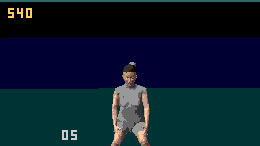
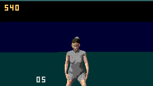
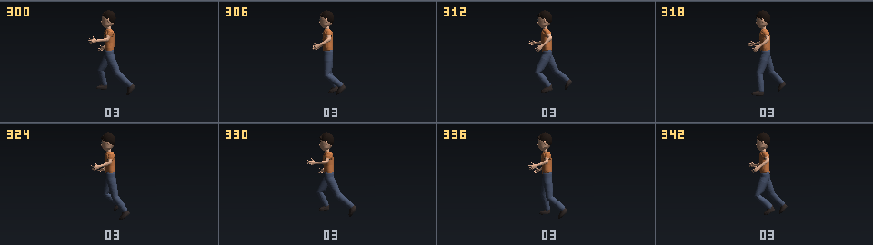
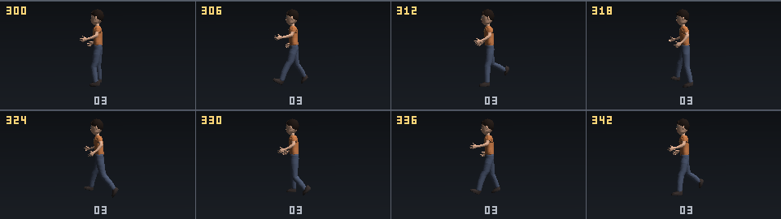

# Animasi aktor — dari klip yang tidak lengkap ke gerak yang terbaca

Dokumen ini mencatat dua lapisan perbaikan pada gerak aktor di studio ini:

1. **klip dasarnya** (`studio-forge/forge/human.py`) — dulu hanya menulis
   sepertiga tulang, jadi seluruh tubuh bergerak seperti satu balok;
2. **lapisan hidup** (`src/studio/life.js`) — gerak tambahan di atas klip
   (napas, tumpuan, kedip, gestur bicara).

Rujukan gaya tetap [ANIMATION&MOTION.md](../../ANIMATION&MOTION.md) §6 (karakter)
dan §9 (irama per beat).

---

## 1. Akar masalah: klip dasar tidak menulis seluruh tubuh

Rig `studio-humanoid-v1` punya **163 tulang**, dan setiap lengan/kaki punya dua
segmen (`upperarm01/02`, `lowerarm01/02`, `upperleg01/02`, `lowerleg01/02`)
plus tulang punggung `spine01..05` dan leher `neck01..03`.

Klip lama hanya menulis segmen **pertama** dari tiap rantai. Akibatnya:

* siku dan lutut membengkok di satu titik — terlihat seperti boneka kayu;
* torso bergerak sebagai satu blok (hanya `spine01`/`spine02` yang ditulis);
* kepala hanya menoleh dari `head`+`neck01`, tanpa `neck02/03`;
* tidak ada kedip sama sekali pada karakter dewasa (tidak ada kanal skala);
* beberapa klip praktis statis.

Diukur dengan `npm run qc:clips` (24 sampel per klip, sudut lokal tiap tulang):

| klip | tulang aktif sebelum | sesudah | gerak total (rad) sebelum → sesudah |
| --- | --- | --- | --- |
| `sit` | 2 / 163 | **54** | 0,3 → **5,9** |
| `idle` (lansia) | 7 / 163 | **59** | 1,3 → **6,8** |
| `walk` | 15 / 163 | **63** | 14,7 → **24,9** |
| `talk` (lansia) | 8 / 163 | **52** | 7,1 → **21,3** |
| `float` | 7 / 163 | **53** | 3,5 → **17,3** |

"Tulang aktif" = tulang yang benar-benar bergerak lebih dari ±0,5 rad selama
satu siklus. Pada `sit` lama hanya **dua** tulang yang bergerak: aktor duduk
benar-benar membeku selama shot.




## 2. Apa yang diubah di klip dasar

* **Putaran dibagi ke seluruh rantai.** `bend(pose, chain, weights, …)` membagi
  satu sudut ke dua segmen dengan bobot panjang segmen (0,62/0,38 untuk paha,
  0,58/0,42 untuk betis, dst). Lutut tidak lagi berengsel di satu titik.
* **Tulang punggung dan leher dipakai semua.** `spine_bend()` dan `neck_bend()`
  membagi lengkung ke lima ruas punggung dan tiga ruas leher; kepala jadi
  *mengikuti* badan, bukan menempel di ujung balok.
* **Jalan memakai empat pose kunci**, bukan satu sinus: kontak → turun →
  lewat → naik. `curve(phase, keys)` mengevaluasi daftar `(fase, nilai)` dengan
  ruas *stance* yang **linear** (0,08–0,56) supaya telapak tidak meluncur saat
  aktor digeser dengan kecepatan tetap.
* **Kontak kaki membaik**: kontak tanah naik dari 14 % → 23–27 % siklus, kaki
  terendah turun dari 0,078 m → 0,065 m (lebih menapak).
* **Kedip masuk ke semua klip** lewat kanal skala `eye.L/eye.R` (konvensi rig
  yang sama dengan `student.py`), jadi karakter dewasa pun berkedip.
* **Tangan hidup**: jari keriting kecil dengan fase berbeda per jari
  (`hands_settle`), pergelangan ikut mengayun, klavikula terangkat saat gestur.
* `run`, `stand-up`, `collapse`, `float`, `vanish`, `reach`, `look`, `point`
  juga memakai rantai penuh, jadi tidak ada lagi klip yang "cuma lengan".

Bukti siklus langkah (kamera uji dari samping, 8 frame berurutan):




### Catatan blocking yang ikut diperbaiki

`bayu-datang-03` dulu memakai `speed: 0.55` + `travel: 1.9` — aktor meluncur
1,9 m/s sementara kakinya hanya bergerak setara ±0,5 m/s, jadi ia terlihat
*skating*. Sekarang `speed: 1`, `travel: 0.9` (≈ kecepatan langkah yang
tersirat klip), dengan kamera `follow` yang menjaga framing.

## 3. Lapisan hidup (napas, tumpuan, gestur)

Setelah klipnya lengkap, sisa masalahnya adalah shot duduk yang tetap tenang.
`src/studio/life.js` menambahkan:

| komponen | fungsi | dasar praktik |
| --- | --- | --- |
| napas 3,4–4,2 s | `A.breathChest`, `breathShoulder`, `breathBob` | siklus napas, dada mengembang, kepala nyaris diam |
| tumpuan berat 7,2–9,4 s | `holdWave()` + `A.weightShift` | *moving hold* di ujung ayunan |
| kedip 2,6–4,4 s | `blinkAmount()` | tutup 0,07 s, jadwal tidak rata; dimatikan bila klip sudah berkedip |
| bicara | `speechGate()`, `mouthOpen()`, `scaleTo('oris05')` | frasa 2,4–3,5 s, suku kata semu |
| angguk & gestur | `beatWave()` | antisipasi → aksi → *moving hold* → *overshoot* → settle |
| mendengarkan | `beatWave()` 55 % | pengangguk kecil |
| fidget 8,5–14 s | `fidget()` | variasi idle |
| mikro-gerak | `A.shimmer` (5,13 s & 2,71 s) | tidak ada frame identik |

Tulang ujung selalu terlambat dari pangkal (kepala 70 ms, tangan 110 ms) —
*overlapping action*. Saat klip sudah mengayun lengan (`walk`/`run`), gestur
bicara dikecilkan ke 25 % agar tetap *subordinate*.

Hasil pada shot duduk `warung-hujan` (`npm run qc:life`, rata-rata mm/frame,
0 frame beku):

| shot | sebelum lapisan hidup | sesudah |
| --- | --- | --- |
| busri-05 | 0,53 | **4,21** |
| nisa-06 | 0,54 | **5,74** |
| nisa-08 | 0,53 | **7,07** |
| bayu-07 | 0,59 | **7,69** |

## 4. Bug yang diperbaiki sepanjang jalan

1. `applySecondary` me-reset pose **per operasi** → napas + ayunan + fidget pada
   tulang yang sama saling menghapus. Sekarang reset sekali per tulang.
2. Tulang gestur (`jaw`, `clavicle`, `upperarm02`, `wrist`, `oculi01`, `oris05`)
   tidak pernah didaftarkan `prepareSecondary` → putarannya dibuang diam-diam.
3. Skala wajah menumpuk pada tulang yang skalanya tidak dianimasikan klip:
   kelopak mata menyusut sampai mata tertutup **69 dari 150 frame**.
   `clip-sample.js` kini memisahkan `scaleNodes`, dan `applySecondary`
   mengembalikan `restScale` lebih dulu.
4. Geseran berat badan ikut menggeser akar properti (kain, lampu) → dibatasi ke
   aktor manusia (`isCharacter`).
5. Bukaan mulut memakai lerp ke nilai absolut, bukan pengali pose istirahat 0,19.

## 5. Menyetel dan memeriksa

```bash
cd studio
npm run qc:clips                      # tulang aktif + besar gerak per klip
npm run qc:life                       # mm/frame & frame beku per shot
npm run qc:motion                     # kecepatan langkah tersirat + kontak kaki
npm run preview:cpu -- --shot bayu-datang-03 --range 300,419,2 --width 320 --gif
npm run preview:cpu -- --shot busri-05 --frames 560,600,640 --mode side
npm run test:studio
./.venv/bin/python studio-forge/build.py --category character --no-thumbs
```

Amplitudo dan jadwal ada di tabel `A` (`life.js`) dan di `*_KEYS` (klip jalan).
`intensity` per shot berasal dari `shot.secondary` di `story.json`.

Bukti visual lain (raster CPU, bukan Chromium):

* `animasi/busri-05-hidup.gif` / `busri-05-tanpa.gif` — pengaruh lapisan hidup
* `animasi/nisa-06-kepala-hidup.gif` — kedip & mulut
* `animasi/kepala-nisa-08-kedip2.png` — rangkaian kedip frame 997–1004
* `animasi/dua-shot-16.png` — dua aktor duduk dalam satu shot

## 6. Batas yang jujur

* Gambar di atas berasal dari `scripts/preview-cpu.mjs`: raster CPU tanpa
  tekstur dan tanpa look-dev. Pose, gerak, kamera, dan proporsi **sama** dengan
  renderer; warna dan cahaya tidak.
* Chromium/SwiftShader untuk Remotion (`.studio-tools/`) tidak ada di sandbox
  ini dan unduhannya diblokir, jadi MP4 final belum bisa dibuat dari sini.
  `npm run render:studio:h264` akan memakai klip baru tanpa perubahan lain.
* Kaki masih bisa meluncur sedikit saat stance (23–27 % kontak, kecepatan
  stance bervariasi ±20 %). Solusi penuhnya foot-lock/IK kaki, belum dikerjakan.
* Lapisan hidup bukan simulasi kain/fisika; ia prosedural dan deterministik.
